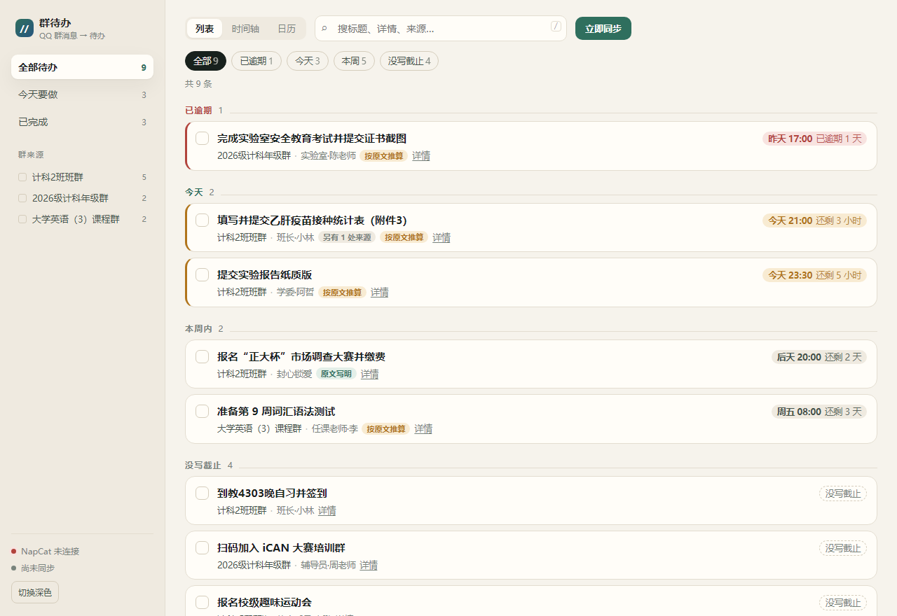
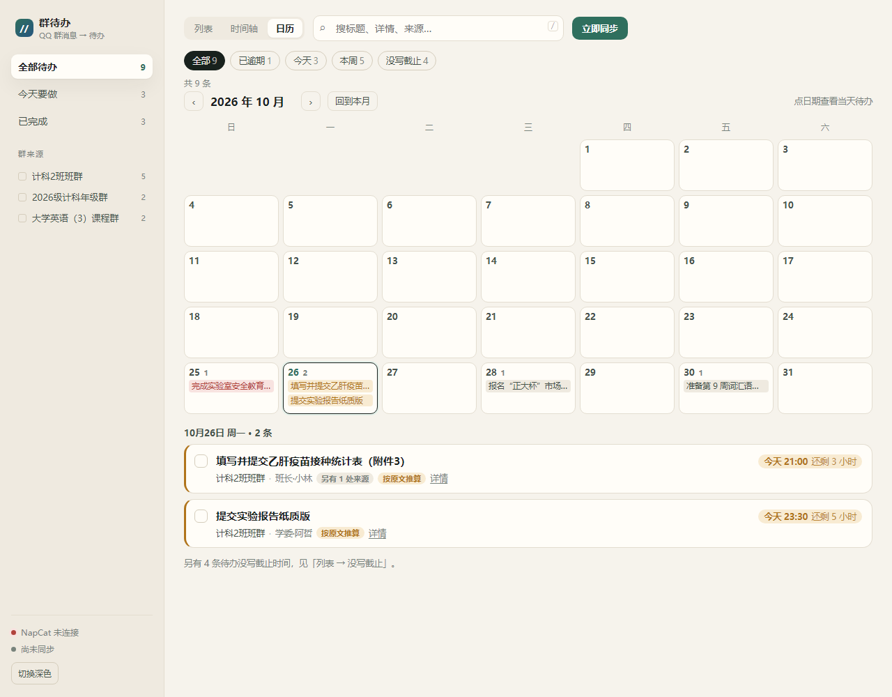
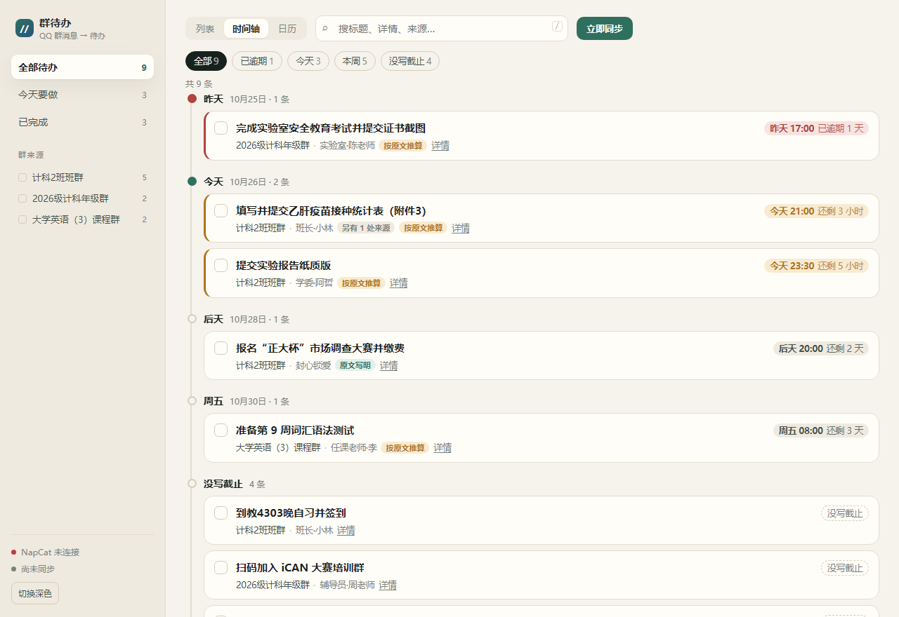
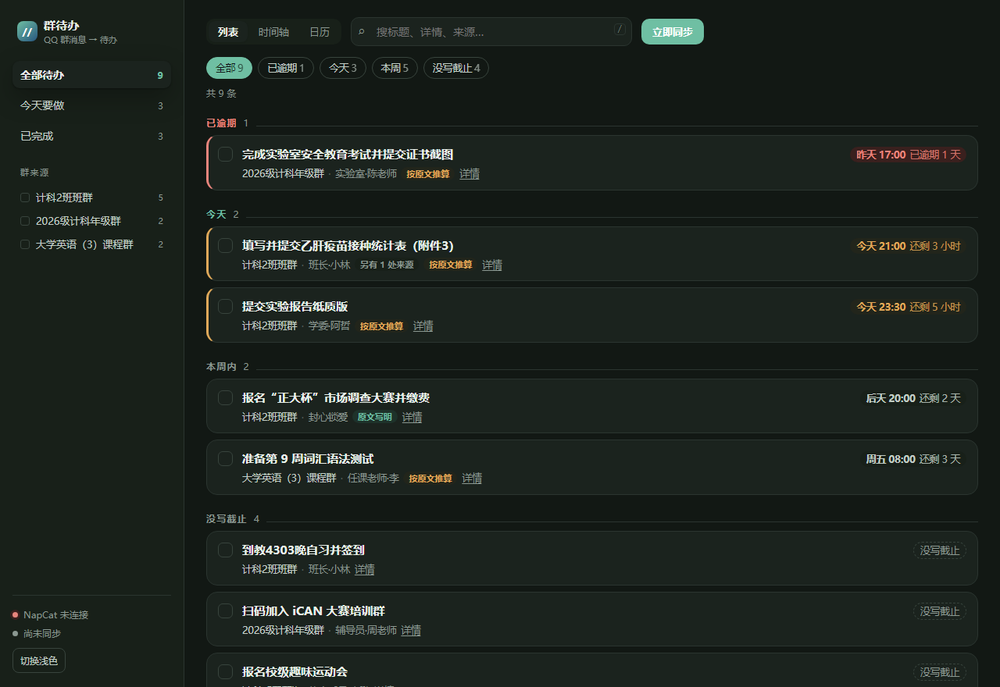

# QQ 待办助手

把 QQ 群消息交给 AI，挑出**真正需要你处理的事**，整理成一张能划掉、能"教它"的待办看板。

班群、年级群、社团群里一天几十条通知，真正要你动手的可能只有三五条。这个项目做的就是：**读群消息 → AI 提炼待办 → 网页看板**，并且**装一次，开机就在**。

---

## 长什么样



| 日历视图 | 时间轴视图 |
|---|---|
|  |  |

| 深色模式 | 手机端 |
|---|---|
|  |  |

> 截图用的是 `docs/demo-data` 里的**编造数据**（工具生成），不含任何真实群名和同学昵称。

---

## 它现在做到的

- **常驻**：注册成 Windows 计划任务后，登录桌面就自动在后台启动，没有黑窗口；关掉浏览器、关掉终端都不影响，改天开机网页照样有东西看。
- **免扫码**：NapCat 支持快速登录（`NapCatWinBootMain.exe <QQ号>`），第一次扫码登录后，之后由程序自动拉起，不用再扫码。
- **掉线自愈**：NapCat 断了会按退避策略自动重启；掉线期间看板照常显示历史待办，只是不会刷新新消息。
- **单实例**：重复启动不会开出第二个进程抢端口，双击 `start.bat` 会直接把已在运行的看板打开。
- **能教它**：标记"这不是待办"会同时记住关键词和消息 ID，以后类似消息不再打扰你。

---

## 你需要准备的东西（3 样）

1. **一台 Windows 电脑**（本项目按 Windows 适配；其他系统需自行改启动方式）
2. **一个 QQ 号**
3. **一个 DeepSeek API Key**（https://platform.deepseek.com → 创建 API Key）

> ⚠️ **先说明**：本项目借助非官方 QQ 自动化框架 **NapCat** 读取群消息。这类工具**有被腾讯封号的风险**（多数人长期用没事，但风险客观存在）。建议先用小号验证，确认稳定再考虑主号。

---

## 第一步：安装 Python

1. 打开 https://www.python.org/downloads/ 下载 Windows 安装包
2. 安装时**勾选** `Add Python to PATH`
3. 装完在终端输入 `python --version`，能看到版本号即可

---

## 第二步：安装并登录 NapCat

1. 打开 https://github.com/NapNeko/NapCatQQ/releases 下载 Windows 版（NapCat.Shell / OneClick 版）
2. 解压后双击启动，会弹出内置 QQ 登录窗口，扫码登录**一次**
3. NapCat 会自动起一个本地 OneBot v11 HTTP 服务，记住它的**端口**和 **access_token**（默认端口常见为 `3000` 或 `6099`）
4. 记下 `NapCatWinBootMain.exe` 的完整路径，下一步要填进配置

---

## 第三步：填配置

装完之后打开 `http://127.0.0.1:8080`，第一次会自动跳到**配置向导**（`/setup`），在网页里填：

1. **DeepSeek API Key**：粘贴 `sk-` 开头的 Key，点「测试」，出现「可用，模型正常回话」即可
2. **NapCat**：填 OneBot 地址、token、QQ 号，路径不确定点「自动查找」，点「测试连接」确认能连上
3. 点「保存并进入看板」

保存即时生效，不用重启；改端口除外。**没有 Key 时看板会自动让位给向导**，想先看界面可以点「直接进入看板」（`/?skip=1`）。

不想用网页也行，直接改 `config.json`（模板是 `config.example.json`）：

```json
{
  "deepseek_api_key": "你的 DeepSeek Key",
  "napcat_base_url": "http://127.0.0.1:3000",
  "napcat_access_token": "NapCat 的 token，没有就留空",
  "napcat_qq_uin": "你的QQ号",
  "napcat_exe": "C:\\NapCat\\NapCatWinBootMain.exe",
  "target_groups": []
}
```

- `napcat_qq_uin`：填了才能**免扫码**快速登录；不想填就留占位符，程序会退回扫码登录
- `napcat_exe`：NapCat 主程序完整路径，程序找不到时也会在常见目录自动搜一遍
- `target_groups`：留 `[]` 处理所有群；只想处理某几个群就填群号，例如 `[123456789]`
- `board_port`：看板端口，默认 `8080`

> 也可以用环境变量 **`DEEPSEEK_API_KEY`** 提供 Key（优先级高于 config.json，适合在 CI / 临时环境里跑）。
> `config.json` 已经写进 `.gitignore`，不会误提交到 GitHub。

---

## 第四步：安装并启动（一键）

在项目目录里执行：

```powershell
powershell -ExecutionPolicy Bypass -File install.ps1
```

它会：找到真实 Python → 补齐依赖 → 注册计划任务 `QQTodoBot` → 立刻在后台启动 → 校验看板是否响应。

看到 `看板已在后台运行：http://127.0.0.1:8080` 就成功了，浏览器打开这个地址即可。

**不想装计划任务**，只想临时跑：双击 `start.bat`。它会先探测后台服务——已经在跑就直接打开看板，没跑才以前台方式临时启动（关窗口就停，仅调试用）。

---

## 开机自启是怎么工作的

- 触发条件：**当前用户登录桌面时**（不需要管理员权限，不登录桌面不会跑）
- 运行方式：`pythonw.exe main.py --background`，无窗口，工作目录固定在项目目录
- **看门狗兜底**：另有一个每 2 分钟探测端口的任务 `QQTodoBot-Watchdog`。Windows 计划任务自带的"失败后重启"在进程被强杀时不会触发，所以真正把服务拉回来的是这一层（实测杀掉进程后 40 秒左右自动恢复）。
- 日志：`logs/app.log`（超过 2MB 自动滚动成 `app.log.1`）；看门狗自己的记录在 `logs/watchdog.log`

常用命令：

```powershell
# 看最近的日志
Get-Content .\logs\app.log -Tail 50

# 重启后台服务
Restart-ScheduledTask -TaskName QQTodoBot

# 看任务状态
Get-ScheduledTask -TaskName QQTodoBot | Select-Object TaskName, State

# 卸载（删任务 + 结束后台进程，数据文件保留）
powershell -ExecutionPolicy Bypass -File uninstall.ps1
```

---

## 手动模式（开发调试用）

```bash
pip install -r requirements.txt

python main.py                  # 前台常驻，会打开浏览器
python main.py --background     # 后台常驻，不弹浏览器（计划任务用的就是这个）
python main.py --port 8090      # 换端口，也支持环境变量 QQTODO_BOARD_PORT
python main.py once             # 等 NapCat 就绪，同步一次再开看板
python main.py serve            # 只看板，不连 NapCat
```

**数据目录可以和代码分开放**：设置环境变量 `QQTODO_DATA_DIR`，`config.json / todos.json / seen.json / logs` 都会落在那个目录里。

**跑一份假数据看效果**（不碰真实数据）：

```powershell
python tools\make_demo_data.py                       # 生成 docs\demo-data\todos.json
$env:QQTODO_DATA_DIR = "docs\demo-data"
python main.py serve --port 8090                     # 打开 http://127.0.0.1:8090/?skip=1
```

---

## 看板怎么用

界面分三块：左边是范围和群筛选，上边是搜索和视图切换，中间是待办列表。

**三个视图**

- **列表**：按「已逾期 / 今天 / 明天 / 本周内 / 以后 / 没写截止」分组，最该先处理的排最前。
- **时间轴**：按具体日期往下排，一眼看出未来几天挤不挤。
- **日历**：月视图，格子里是当天截止的事项；点某一天，下面列出那天的全部待办。

**筛选**

- 左侧导航：全部待办 / 今天要做 / 已完成
- 顶部标签：全部 / 已逾期 / 今天 / 本周 / 没写截止 / 来源待确认
- 左侧「群来源」：点群名只看这个群，可多选
- 搜索框：标题、说明、群名、发送者、消息引文都能搜

**小操作**

- 点左边的方框 = 标记完成；在「已完成」里再点 = 恢复
- 「详情」展开后能看到发送时间、原文说法、完整说明和多来源引用
- 键盘 `/` 聚焦搜索，`Esc` 清空并收起侧栏
- 侧栏底部「切换深色」，深浅色选择会被浏览器记住
- 深链接：`#list` / `#timeline` / `#calendar` 直接打开对应视图，`?theme=dark` 指定主题
- 页面每 10 秒自动拉一次数据；切到后台标签页时暂停刷新，不浪费电

---

## 怎么"教它"

展开一条待办的「详情」，有三个按钮：

- **标记完成**（或直接点左侧方框）：划掉，移到"已完成"
- **这不是待办**：删除这条，并**记住**关键词 + 消息 ID，以后类似消息不再提醒
- **删除**：只删这条，不教它

---

## 数据存在哪儿、长什么样

每条待办都带**来源清单**和**时间来源标记**（下面示例里的群名、人名都是编的）：

```json
{
  "title": "填写并提交乙肝疫苗接种统计表",
  "published_at": "2026-10-26 15:10",   // 群消息发出的时间
  "start_at": null,                      // 任务开始时间；原文没写就是 null，不拿发布时间冒充
  "deadline": "2026-10-26 21:00",
  "deadline_basis": "inferred",          // explicit 原文写明 / inferred 按原文推算 / none 没写
  "deadline_raw": "今晚9点前",           // 原文里的那句话，保留可追溯
  "event_key": "a1b2c3d4e5f6",
  "sources": [
    {"group": "计科2班班群", "sender": "班长·小林", "msg_id": "101",
     "time": "2026-10-26 15:10", "quote": "……", "confidence": "exact"},
    {"group": "2026级计科年级群", "sender": "辅导员·周老师", "msg_id": "102",
     "time": "2026-10-26 15:25", "quote": "……", "confidence": "matched"}
  ]
}
```

## 它怎么判断"这是同一件事"

- 标题先去掉"通知/请/提交/相关"这类通用词，再比字面重合度，避免"提交乙肝表"和"填写乙肝表"各存一条。
- **数字必须对得上**：`10月9日` 和 `10月11日`、`附件2` 和 `附件3` 一律当两件事，不会误合并。
- 同一批次里别的群转发的同一份通知，会被**补挂成额外来源**（`confidence: matched`），所以卡片上能看到"另有 N 处来源"。
- 已经完成的待办，只要截止日相同，**不再因为群消息转发而复活**。
- 同名任务换了截止日期（比如下周的新表），会正常作为新任务出现。

## 截止时间是怎么来的

模型只负责把原文说法**照抄**出来（`今晚9点前`、`本周五下午6点前`、`10月9日12:00前`），换算全部由代码做，避免模型心算出错：

| 原文片段 | 消息时间 | 结果 | 标注 |
|---|---|---|---|
| 今晚9点前 | 10-26 15:10 | 10-26 21:00 | inferred |
| 明天下午6点前 | 10-26 15:10 | 10-27 18:00 | inferred |
| 本周五下午6点前 | 10-26 15:10 | 10-30 18:00 | inferred |
| 下周五 | 10-26 | 11-06 23:59 | inferred |
| 10月9日12:00前 | 10-06 | 10-09 12:00 | explicit |
| 月底前 | 10-26 | 10-31 23:59 | inferred |

看板上"按原文推算"的小标签就是 `inferred`；"原文没写截止"意味着消息里真的没有时间，而不是漏抓。

## 跑测试

```bash
python -m unittest discover -s tests -v
```

覆盖时间换算（含跨周末、跨月、只有时间没有日期）、同事件判定（含数字冲突反例）、合并落库（跨群合并 / 已完成不复活 / 不同截止日算新任务）。

## 常见问题

**Q：网页打不开 / 打开是空白**
A：先看 `logs/app.log` 有没有"看板已就绪"。如果任务没在跑，执行 `Start-ScheduledTask -TaskName QQTodoBot`。

**Q：状态一直显示"NapCat 未连接"**
A：核对 `napcat_base_url` 端口和 `napcat_access_token`；NapCat 窗口里扫码是否还在登录态。看板本身不受影响。

**Q：每次还是要扫码？**
A：`napcat_qq_uin` 没填或填错。NapCat 的快速登录要求这个 QQ 号在本机**成功登录过一次**；换个 QQ 号或清了登录态就得重新扫一次。

**Q：电脑关机时群里的消息能抓到吗？**
A：抓不到。本方案依赖本机 NapCat 在线，开机后能拉到它历史记录范围内的消息（`history_count`，默认每群最近 50 条）。想要 24 小时在线，得让机器常开或放到云服务器/VPS 上。

**Q：AI 有时不聪明？**
A：正常，多按"这不是待办"教几次就会收敛；也可以调 `deepseek_model` 换更强的模型。

---

## 文档

| 文件 | 给谁看 |
|---|---|
| [产品使用手册](docs/手册与说明书/QQ待办助手-使用手册.pdf) | 想把它用起来的人：安装、配置向导、看板操作、常见问题 |
| [产品说明书](docs/手册与说明书/QQ待办助手-产品说明书.pdf) | 评审 / 协作者：产品概述、目标用户、核心功能、AI 的角色与价值、技术实现思路、应用场景 |

两份 PDF 由 `python tools/build_docs.py` 从同一份源码生成（reportlab + 系统字体，无外部排版工具）。

---

## 目录结构

```
qq-todo-bot/
├── main.py               # 主程序：看板服务 + 同步线程 + NapCat 守护
├── config.example.json   # 配置模板（复制成 config.json 再填）
├── config.json           # 你的配置（已 gitignore）
├── requirements.txt      # 依赖
├── install.ps1           # 一键注册开机自启（主任务 + 看门狗）并启动
├── uninstall.ps1         # 卸载两个计划任务并结束后台进程
├── watchdog.ps1          # 看门狗：每 2 分钟探测看板，挂掉自动拉起
├── start.bat             # 双击即用：服务在跑就开看板，没跑就前台临时启动
├── web/index.html        # 待办看板（单文件，零外部依赖，可离线打开样式）
├── web/setup.html        # 配置向导（填 Key / NapCat，点测试即验证）
├── tools/make_demo_data.py  # 生成假演示数据（截图、演示用）
├── docs/demo-data/       # 假数据
├── docs/screenshots/     # README 用的截图
├── docs/手册与说明书/     # 使用手册、产品说明书（PDF）
├── tests/test_core.py    # 核心逻辑单测
├── logs/app.log          # 运行日志（运行时生成）
└── todos.json / seen.json / ignore_keywords.json   # 待办与去重数据（运行时生成，已 gitignore）
```
